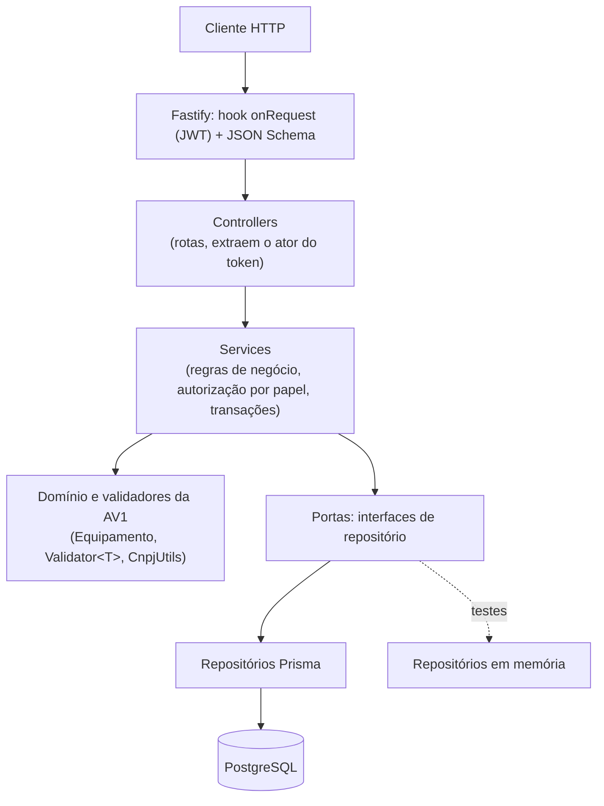

# AV2 — Arquitetura do servidor monolítico

Este documento explica **o que** foi construído e, principalmente, **por quê**: as decisões, os *trade-offs* aceitos e as alternativas rejeitadas, como pede o enunciado da AV2.

## 1. Da AV1 para a AV2

| Aspecto | AV1 (CLI) | AV2 (servidor) | Motivo da mudança |
|---|---|---|---|
| Interface | Linha de comando (`readline`) | API REST (Fastify) | Múltiplos usuários simultâneos e consumo por um front-end SPA. |
| Persistência | Arquivos de texto cifrados (AES-256-GCM), leitura/escrita do arquivo inteiro | PostgreSQL via Prisma ORM | Concorrência, integridade referencial, consultas e volume. |
| Atomicidade | Arquivo temporário + `rename` | Transações ACID (`$transaction`) | Operações compostas (lote + equipamentos; status + movimentação). |
| Auditoria | Journal cifrado em arquivo (rotação 10 MB, retenção 180 dias) | Tabela `Movimentacao` **append-only** (trigger) | A trilha agora é relacional e consultável (`rastreio`). |
| Sessão | Arquivo de sessão, expira após 30 min de inatividade | JWT *stateless* com expiração de 30 min | API sem estado, escalável horizontalmente. |
| Senhas | PBKDF2-HMAC-SHA256 + salt (`HashService`) | **O mesmo `HashService`** | Reaproveitamento direto; ver §5.4. |
| Autorização | `MenuManager` (matriz papel × comando) | `politicas.ts` (mesma matriz) consultada pelos serviços | A regra continua independente do transporte. |
| Regras de negócio | Validadores (Template Method), domínio OO, fábrica | **Os mesmos**, reutilizados | A AV1 já isolava o domínio; a migração não reescreve regras. |

O CLI da AV1 **continua existindo e funcionando** (`src/` fora de `src/server`); a AV2 foi adicionada ao lado, sem apagar nada.

## 2. Camadas: Controller → Service → Repository



| Camada | Pasta | Responsabilidade | O que **não** faz |
|---|---|---|---|
| Controllers | `src/server/controllers` | Receber a requisição HTTP, validar o formato (JSON Schema), extrair o *ator* (id + papel) do JWT, chamar o serviço, escolher o status HTTP. | Regra de negócio, acesso a dados. |
| Services | `src/server/servicos` | Toda a lógica: validações, transições de status, cálculos financeiros, autorização por papel, fronteiras de transação, controle de versão. | Conhecer HTTP, Fastify ou Prisma. |
| Repositories | `src/server/repositorios` | Persistência. As **portas** (`portas.ts`) são interfaces; `prisma/` as implementa. | Regra de negócio. |

**Por que as portas (interfaces) existem?** O enunciado diz que a lógica de negócio deve ficar "imune a mudanças na interface de comunicação". Ir um passo além e isolar também a persistência trouxe um ganho concreto: os serviços foram testados com repositórios em memória (90 verificações sem banco), inclusive o *rollback* de transações. O custo é uma camada de interfaces a mais, mantida em um único arquivo.

### Estrutura de pastas (AV2)

```
prisma/
  schema.prisma                       # modelo de dados
  migrations/                         # migrações versionadas (SQL)
  seed.ts                             # massa de dados
src/server/
  server.ts                           # entrada: porta por env, graceful shutdown
  app.ts                              # monta o Fastify (plugins, hooks, erros)
  config/env.ts                       # variáveis de ambiente validadas (fail-fast)
  erros.ts                            # erros HTTP + tradução de qualquer erro
  schemas.ts                          # JSON Schemas de entrada
  tipos-jwt.ts                        # tipagem do payload do token
  plugins/autenticacao.ts             # hook JWT + extração do ator
  controllers/                        # um arquivo por recurso
  servicos/                           # regras de negócio (+ politicas, dto, util)
  repositorios/portas.ts              # interfaces
  repositorios/prisma/index.ts        # implementação Prisma + executor de transação
tests/server/                         # testes (repositórios em memória, HTTP)
```

## 3. O que foi reaproveitado da AV1

- **Validadores** (`Validator<T>`, `OrganizacaoValidator`, `LoteValidator`, `TransicaoStatusValidator`, `MudancaEstadoFisicoValidator`, `CnpjUtils`): os serviços da AV2 os chamam como estão. As regras (CNPJ com dígitos verificadores, janela de 90 dias, desmonte só após triagem, justificativa em queda ≥ 2 categorias) foram **transportadas sem reescrita**.
- **Domínio OO e polimorfismo** (`Equipamento` e subclasses, `EquipamentoFactory`): o relatório de valor residual reconstrói o objeto de domínio e delega a ele `calcularValorResidual` e `potencialRecuperacao`. Resultado visível: um servidor inservível é classificado como `RECICLAGEM` e um nobreak inservível como `DESCARTE_SEGURO`.
- **`HashService`** e **tipos/enums** (`Papel`, `StatusEquipamento`, `EstadoFisico`…).

## 4. Decisões arquiteturais e alternativas rejeitadas

### 4.1 Monólito (e não microsserviços)
- **Escolha:** uma aplicação, um banco, um deploy.
- **Por quê:** estágio inicial do negócio; coesão do código; depuração e implantação simples; transações ACID locais cobrem as operações compostas sem precisar de *sagas*.
- **Rejeitado:** microsserviços (organizações, lotes, equipamentos). Trocariam transações locais por consistência eventual, e exigiriam orquestração e observabilidade que o time e o volume atual não justificam.

### 4.2 Fastify (e não Express)
- **Escolha:** Fastify 4.
- **Por quê:** validação nativa por JSON Schema (o formato das entradas é um contrato declarativo, executado antes do handler), *hooks* de ciclo de vida (autenticação e log), encapsulamento por plugins (o hook de JWT vale só no escopo protegido), tratamento de erros centralizado e melhor desempenho.
- **Rejeitado:** Express — viável, mas exigiria bibliotecas extras para validação e não tem o encapsulamento de plugins.

### 4.3 Prisma ORM (e não SQL cru ou query builder)
- **Escolha:** Prisma Client, com `schema.prisma` declarativo e migrações versionadas.
- **Por quê:** tipagem forte ponta a ponta com TypeScript, *eager loading* (`include`) e seleção de campos, `$transaction` interativa.
- **Trade-off aceito:** o Prisma não modela `CHECK` nem *trigger*; essas regras ficam em SQL puro numa migração dedicada. O **fallback** é explícito e documentado.
- **Rejeitado:** SQL manual (mais controle, porém sem tipagem e com mais código repetitivo); TypeORM (decoradores e `synchronize` conflitam com migrações versionadas).

### 4.4 PostgreSQL (e não MySQL ou SQLite)
- **Escolha:** PostgreSQL.
- **Por quê:** transações ACID, `UUID`, `JSONB` (as cláusulas do contrato são semiestruturadas), `CHECK`, enums nativos e *triggers* PL/pgSQL.
- **Rejeitado:** SQLite (mais simples de instalar, mas sem enums/`JSONB`/triggers equivalentes e sem concorrência de escrita real, ou seja, esconderia justamente os problemas que a AV2 quer tratar).

### 4.5 JWT *stateless* (e não sessões em servidor)
- **Escolha:** `@fastify/jwt`, token assinado (HS256) com `sub`, `username` e `papel`, expiração de 30 min.
- **Por quê:** API REST sem estado; qualquer instância valida o token sem consultar banco.
- **Trade-offs aceitos (honestos):**
  1. A AV1 expirava a sessão por **inatividade**; o JWT expira por **tempo absoluto** (30 min desde a emissão). Para renovar por atividade seria preciso *refresh token* — fora do escopo.
  2. **Não há revogação** antes do vencimento (desativar um usuário só impede novos logins; o token em circulação vale até expirar). A janela curta mitiga.
  3. O papel vai no token; se mudar no banco, vale após o próximo login.

### 4.6 Hash de senha: PBKDF2-HMAC-SHA256 do `HashService` (e não bcrypt)
- **Escolha:** manter o `HashService` da AV1 (PBKDF2-HMAC-SHA256, salt aleatório, 210 mil iterações, comparação em tempo constante).
- **Por quê:** o enunciado pede "a mesma biblioteca de criptografia que você empregou no CLI, como bcrypt"; a "mesma" aqui é o módulo `crypto` do Node. Evita dependência nativa (compilação no Windows) e mantém compatibilidade: hashes gerados pelo CLI continuariam válidos na API.
- **Rejeitado:** `bcrypt` (módulo nativo, fricção de instalação) e `argon2` (excelente, mas dependência nativa). Ambos são evoluções razoáveis em produção.
- Mitigação extra: o login executa uma verificação de hash completa mesmo quando o usuário não existe (resposta com tempo similar, sem enumeração de contas).

### 4.7 Concorrência: versionamento otimista (e não bloqueio pessimista)
- **Escolha:** coluna `versao` em todos os modelos; toda atualização é `UPDATE … WHERE id = ? AND versao = ?` com `versao + 1`. Se afetar 0 linhas, outra requisição chegou antes → `409 Conflict`. O cliente pode ainda enviar a versão que leu (precondição), recebendo `409` imediatamente se estiver defasada.
- **Por quê:** evita *lost updates* sem manter bloqueios de linha durante o tempo de "pensar" do usuário; conflitos reais são raros nesse domínio.
- **Rejeitado:** `SELECT … FOR UPDATE` (bloqueios longos, risco de *deadlock*, pior para uma API com clientes remotos).
- **Limite:** não serializa operações independentes; para invariantes entre linhas (ex.: orçamentos) seria preciso `SERIALIZABLE` ou restrições no banco.

### 4.8 Transações: onde e por quê

| Operação | Dentro de `$transaction` | Por quê |
|---|---|---|
| `POST /lotes` (com equipamentos) | Lote + N equipamentos + N movimentações de cadastro | Nunca deve restar lote "meio criado". |
| `POST /lotes/:id/equipamentos` | Equipamento + movimentação de cadastro | Todo equipamento deve ter histórico. |
| Triagem / estado físico / status | `UPDATE` com versão + movimentação | Sem trilha de auditoria sem o fato, nem fato sem trilha. |

Os repositórios recebem um *client* transacional: o mesmo código roda dentro ou fora de uma transação. O *timeout* da transação foi elevado a 20 s (padrão do Prisma: 5 s) para acomodar lotes grandes.

### 4.9 Integridade em duas camadas (serviço **e** banco)
As regras críticas existem no serviço (mensagens claras, 422) **e** no banco (última linha de defesa contra bug ou acesso direto): `UNIQUE` (CNPJ, código de barras, username, nº de contrato), `FOREIGN KEY`, `CHECK` (formato do CNPJ, estado físico 0–4, vigência do contrato, justificativa em queda de estado, desmonte só após triagem, parâmetros) e *trigger* que torna `Movimentacao` imutável. Duplicar é deliberado: o custo é manter duas definições; o ganho é que um estado inconsistente não consegue ser persistido. Detalhes em [AV2_BANCO_DE_DADOS.md](AV2_BANCO_DE_DADOS.md).

### 4.10 Outras decisões menores
- **Quantidade de equipamentos do lote não é coluna:** é calculada por contagem da relação (normalização; evita contador dessincronizado e contenção de escrita no lote).
- **`estadoFisico` como inteiro (0–4):** mesmo ordinal da AV1; permite `CHECK` aritmético (queda ≥ 2). A API sempre expõe o **nome** (`BOM`, `RUIM`…).
- **IDs `UUID` gerados na aplicação:** permitem `createMany` de equipamentos e movimentações referenciando-se sem *round-trips*.
- **Paginação em todas as listagens** (`limite` máx. 200): protege contra respostas gigantes com o volume crescente.
- **Validação estrita de entrada** (`additionalProperties: false`, sem remoção silenciosa): um campo com erro de digitação resulta em `400`, não em dado ignorado.
- **Erros 5xx genéricos:** o detalhe interno só vai ao log, nunca à resposta.
- **Sem CORS habilitado:** não há front-end ainda; será configurado com a origem correta na etapa do SPA, em vez de abrir `*` agora.
- **Status do lote:** a coluna e o enum existem desde a AV1 (que também não tinha transições); permanece em `RECEBIDO`. Não inventei regras de transição que o enunciado não pede.

## 5. Graceful shutdown e configuração

- A **porta** vem de `PORT` (padrão 3000). Todas as variáveis são validadas na partida (`config/env.ts`): faltou `DATABASE_URL` ou o `JWT_SECRET` é curto → o processo não sobe, com mensagem clara.
- Em `SIGINT`/`SIGTERM`, o servidor para de aceitar conexões, aguarda as requisições em andamento (`app.close()`), desconecta o Prisma (hook `onClose`) e sai com código 0. Um temporizador de segurança (`SHUTDOWN_TIMEOUT_MS`) força a saída se travar.

## 6. Segurança — resumo

- Senhas com PBKDF2-SHA256 + salt; JWT assinado com segredo ≥ 32 caracteres vindo do ambiente (nunca no código; `.env` está no `.gitignore`).
- Autorização por papel nos **serviços** (não só nas rotas): mesmo que um controller novo esqueça a checagem, a regra vive onde a operação acontece.
- Validação de entrada por JSON Schema antes de qualquer lógica; SQL parametrizado pelo Prisma (sem concatenação).
- **Não portado da AV1, de propósito:** a cifragem AES-256 de arquivos. Os dados agora estão no PostgreSQL; a proteção em repouso passa a ser responsabilidade da infraestrutura (disco/volume cifrado, TLS na conexão, backups cifrados).
- **Para produção (fora do escopo):** TLS na borda, *rate limiting* no login, *refresh tokens*/revogação, rotação do segredo JWT, e papéis de banco com privilégios mínimos.

## 7. Limites do monólito (reflexão pedida no enunciado)

O monólito foi a escolha certa **para este estágio**, mas tem limites que vale conhecer:

1. **Escala acoplada:** relatórios pesados e operações de triagem escalam juntos. Mitigação: réplicas de leitura e/ou filas.
2. **Deploy único:** uma mudança no cadastro redeploya a triagem. Mitigação: pipeline de testes (já há ~120 verificações sem banco).
3. **Banco compartilhado:** é o ponto único de contenção e de falha.
4. **Fronteiras por convenção:** as camadas só se mantêm com disciplina (as interfaces de repositório ajudam a impor isso).
5. **Candidatos naturais a extração futura:** (a) **relatórios/inteligência de mercado** (carga analítica, leitura intensiva); (b) **integração com cotações de matérias-primas** (dependência externa); (c) **emissão de certificados de compensação ambiental** (ciclo de vida e requisitos regulatórios próprios). A separação em serviços/portas já deixa essas costuras visíveis.

## 8. Compatibilidade de plataformas

Somente dependências multiplataforma e sem compilação nativa local (o Prisma baixa seus binários para Windows e Linux). Caminhos via `path`, *scripts* sem sintaxe de shell específica, `docker-compose.yml` opcional. Destino: Windows 10+ e Ubuntu 24.04+ (e derivadas), Node ≥ 18.18.
