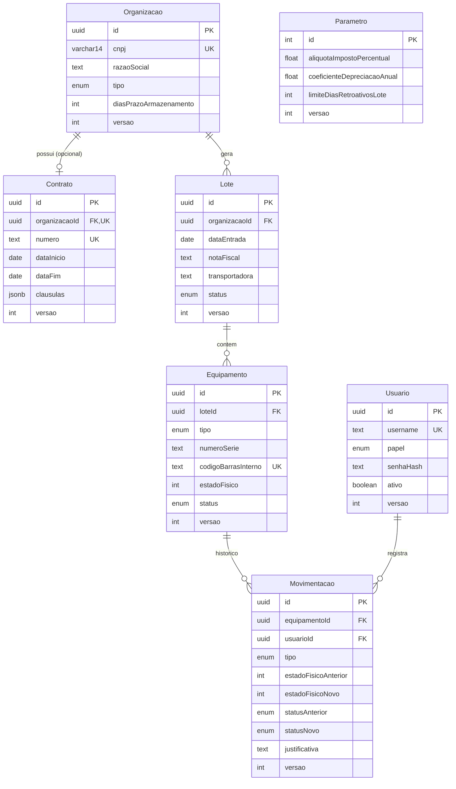

# AV2 — Banco de dados (PostgreSQL + Prisma)

## Modelo entidade-relacionamento



`Usuario` (autenticação) e `Parametro` (parâmetros globais do administrador, o "config" da AV1) foram adicionados aos cinco modelos citados no enunciado porque a AV1 já os tinha e a API precisa deles. `Parametro` é uma tabela de **linha única** (`id = 1`).

## Relacionamentos

| Relação | Cardinalidade | Como |
|---|---|---|
| Organizacao → Contrato | 1 : 0..1 | `Contrato.organizacaoId` é `UNIQUE` (no máximo um) e opcional do lado da organização. |
| Organizacao → Lote | 1 : N | `Lote.organizacaoId` + índice. |
| Lote → Equipamento | 1 : N | `Equipamento.loteId` + índice. A quantidade **não** é coluna: é contada (normalização). |
| Equipamento → Movimentacao | 1 : N | `Movimentacao.equipamentoId` + índice composto `(equipamentoId, criadoEm)`. |
| Usuario → Movimentacao | 1 : N | Quem executou cada alteração. |

Todas as chaves estrangeiras usam `ON DELETE RESTRICT ON UPDATE CASCADE`: nada é apagado em cascata e uma linha referenciada não pode ser removida.

## Restrições no banco (integridade além do serviço)

**Unicidade (`UNIQUE`):** `Organizacao.cnpj`, `Equipamento.codigoBarrasInterno`, `Usuario.username`, `Contrato.numero`, `Contrato.organizacaoId`.

**`CHECK`** (migração `…_integridade_checks_e_triggers`):

| Constraint | Garante |
|---|---|
| `ck_organizacao_cnpj_formato` | CNPJ com exatamente 14 dígitos. |
| `ck_organizacao_email`, `ck_organizacao_prazo` | E-mail com formato mínimo; prazo ≥ 0. |
| `ck_contrato_vigencia` | `dataFim > dataInicio`. |
| `ck_equipamento_estado_fisico` | Estado físico entre 0 e 4. |
| `ck_movimentacao_estados_validos` | Estados anterior/novo entre 0 e 4 (ou nulos). |
| `ck_movimentacao_justificativa_queda` | Em `MUDANCA_ESTADO`, queda ≥ 2 categorias exige justificativa de ≥ 10 caracteres. |
| `ck_movimentacao_desmonte_apos_triagem` | Ir para `EM_DESMONTE` só a partir de `TRIADO`. |
| `ck_movimentacao_triagem_status` | A triagem sempre termina em `TRIADO`. |
| `ck_parametro_*` | Linha única; alíquota e depreciação em 0–100; janela de 1–3650 dias. |
| `ck_*_versao` | `versao >= 1` em todas as tabelas. |

**Trigger:** `trg_movimentacao_imutavel` bloqueia `UPDATE` e `DELETE` em `Movimentacao` (trilha de auditoria *append-only*, equivalente ao "journal imutável" da AV1).

**O que fica só no serviço (e por quê):** a validação dos *dígitos verificadores* do CNPJ e a janela de datas do lote (depende do "agora" e de um parâmetro configurável, então não cabe em `CHECK` imutável).

> **Sobre o estado físico como inteiro:** `4 = NOVO`, `3 = BOM`, `2 = REGULAR`, `1 = RUIM`, `0 = INSERVIVEL` (o mesmo ordinal da AV1). A API converte de/para o nome.

## Controle de versão otimista

Cada tabela tem `versao INTEGER NOT NULL DEFAULT 1`. A atualização é `UPDATE … SET …, versao = versao + 1 WHERE id = ? AND versao = ?`; se nenhuma linha for afetada, há conflito (`409`). `Movimentacao` é imutável, então sua `versao` permanece 1 (existe apenas por uniformidade do modelo).

## Migrações versionadas

```
prisma/migrations/
  migration_lock.toml
  20261022120000_init/                              # enums, tabelas, índices, UNIQUEs, FKs
  20261022120100_integridade_checks_e_triggers/     # CHECKs e trigger (SQL puro)
```

```bash
npx prisma migrate deploy        # aplica as migrações pendentes (use em instalação nova/produção)
npx prisma migrate dev           # desenvolvimento: aplica e permite criar novas migrações
```

Para evoluir o esquema: altere `schema.prisma` e rode `npx prisma migrate dev --name descricao_da_mudanca`; o Prisma gera a nova pasta de migração, que deve ser versionada no Git.

> **Nota:** o `migration.sql` inicial foi escrito seguindo o formato que o Prisma gera para este `schema.prisma`. Se `migrate dev` apontar divergência (*drift*), deixe-o gerar uma migração corretiva; `migrate deploy` aplica o que está versionado sem exigir isso.

## Seed (massa de dados)

`npm run db:seed` (ou `npx prisma db seed`) popula o banco **pela camada de serviços**, com o usuário/papel adequado a cada passo, de modo que as regras de negócio são exercitadas na própria carga e cada alteração gera sua `Movimentacao`.

| O que cria | Cenários que cobre |
|---|---|
| 4 usuários (um por papel) e parâmetros (alíquota 9,25 %) | RBAC |
| 4 organizações (hospital, banco, universidade, varejo) | Tipos variados; **uma sem contrato** (contrato é opcional) |
| 3 contratos com cláusulas JSON diferentes | `JSONB` semiestruturado |
| 5 lotes (um **vazio**), 12 equipamentos | Todos os 6 tipos de equipamento |
| Equipamentos em `AGUARDANDO_TRIAGEM`, `TRIADO`, `EM_DESMONTE`, `RECICLADO` e `DESCARTADO` | Máquina de estados completa |
| Queda `BOM → RUIM` **com** justificativa; queda de 1 categoria **sem** | Regra da justificativa |
| Estados físicos de `NOVO` a `INSERVIVEL` | Cálculo de valor residual |

É idempotente: se já houver dados, não faz nada. `SEED_RESET=1` apaga tudo (`TRUNCATE`, que não aciona o trigger de imutabilidade) e recria.

Ao final, o seed imprime IDs úteis para testar manualmente as regras (por exemplo, um equipamento ainda `AGUARDANDO_TRIAGEM` para comprovar que o desmonte é recusado).
