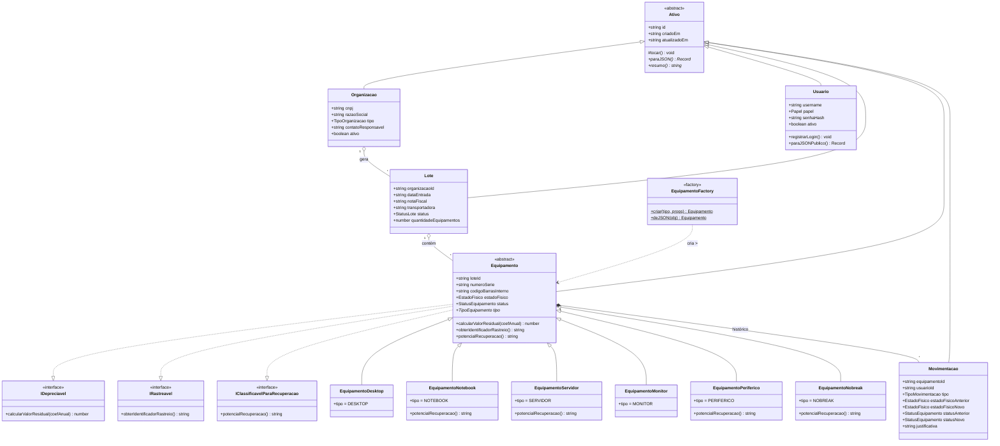
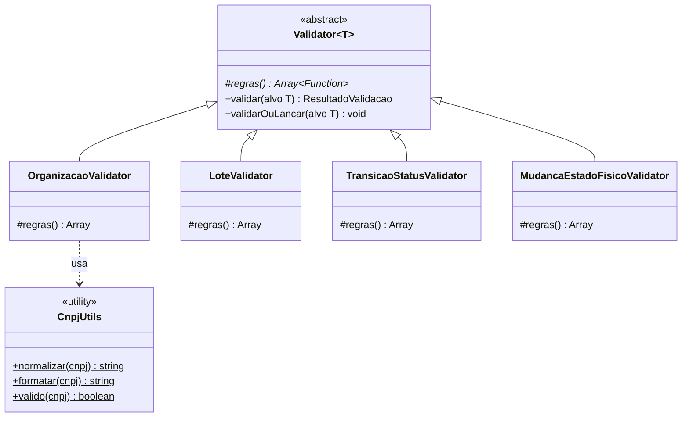
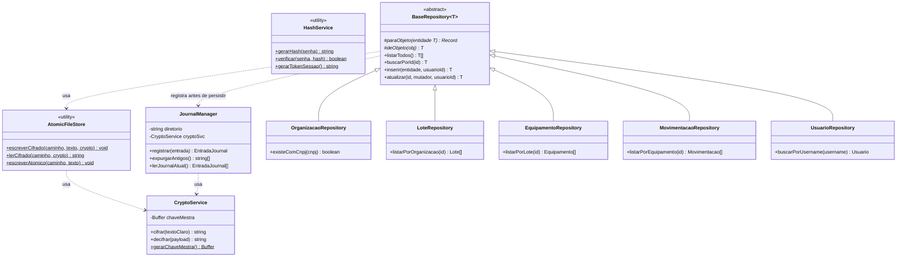
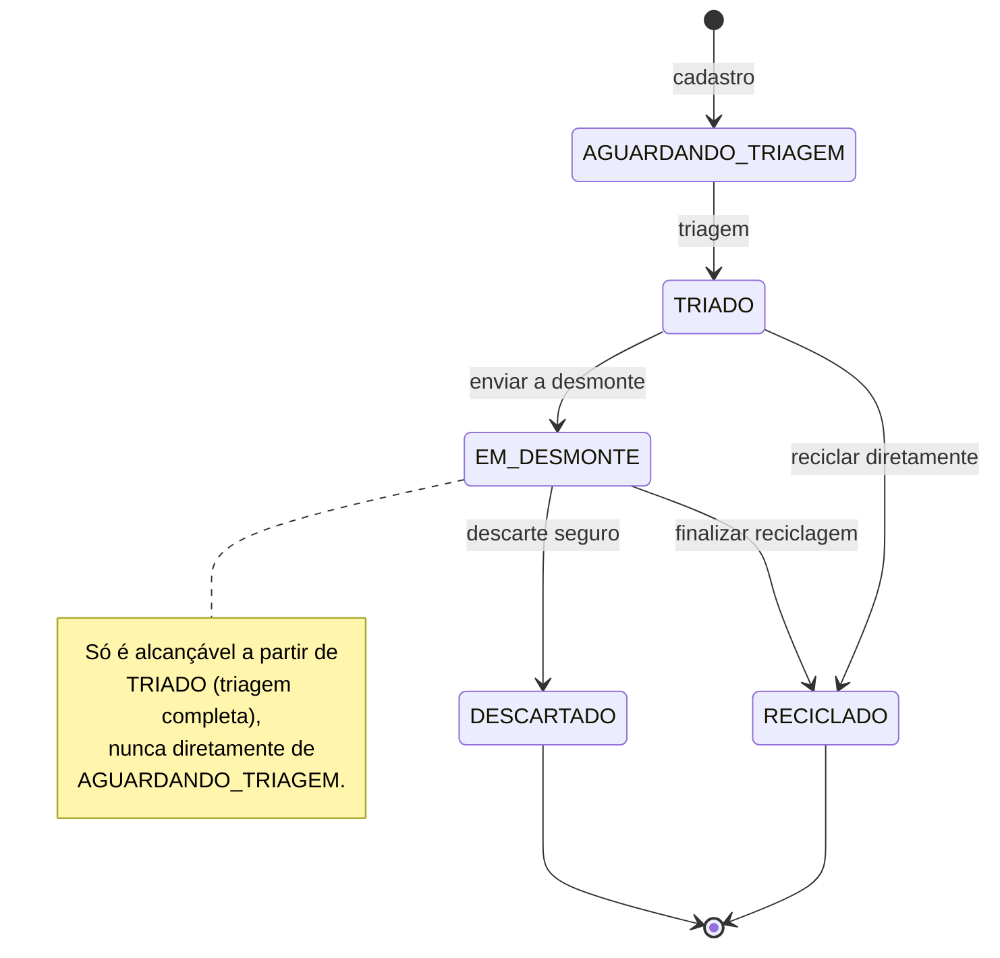

# Modelo de Classes (UML)

Este diagrama é renderizado automaticamente pelo GitHub (formato [Mermaid](https://mermaid.js.org/)). Ele cobre o núcleo de domínio do sistema — heranças, interfaces, polimorfismo e a fábrica de objetos compostos exigidos pelo enunciado. Para a visão de camadas completa (incluindo serviços, repositórios e CLI), ver [ARQUITETURA.md](ARQUITETURA.md).

## Domínio: herança, interfaces e fábrica

## Validação: Template Method

## Persistência e repositórios (genéricos)

## Máquina de estados: Status do Equipamento

